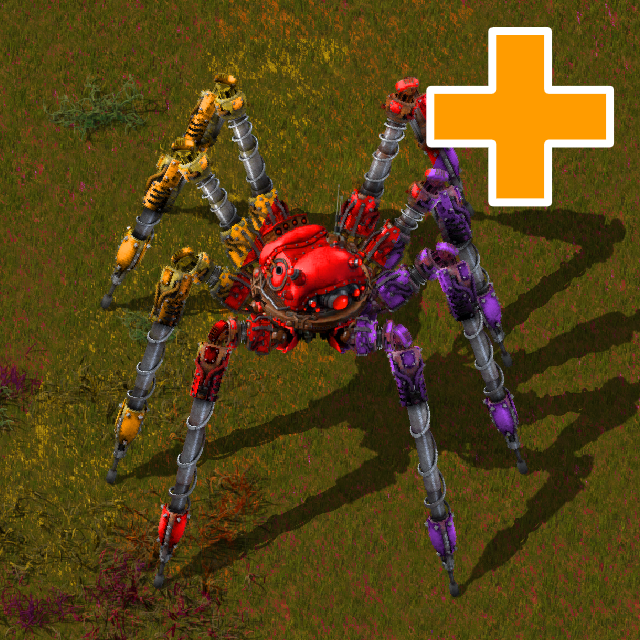

# Spidertron Extended



A Factorio mod that adds five upgraded Spidertrons: the **Spidertron MK2**, **Spidertron MK3**, **Ghost Weaver**, **Immolator** and **Major Spidertron**. Most of them are crafted from the original Spidertron. They have stronger weapons, larger inventories and equipment grids, more health and radar coverage, and special abilities.

- **Factorio:** 2.1 (`base >= 2.1`)
- **Space Age:** supported, with its own recipes
- **Current version:** 0.4.14. See [changelog.txt](changelog.txt).

## The spidertrons

Each one is unlocked by its own technology, and each can be turned off in the startup settings. Health, inventory size and equipment grid size are all adjustable; the defaults are listed below.

| Spidertron | Health | Inventory | Grid | Weapons and abilities |
|---|---|---|---|---|
| Vanilla Spidertron | 3000 | 80 | 10×6 | Unchanged, but its grid, inventory and health can be adjusted |
| **Spidertron MK2** | 5000 | 100 | 20×8 | 4 rocket launchers (54 range) |
| **Spidertron MK3** | 8000 | 120 | 30×10 | 4 rocket launchers (72 range), repairs itself at 15 HP/s |
| **Ghost Weaver** | 3000 | 240 + 20 trash | 16×8 | Built-in Weaving Beam (repair) and Reaping Beam (attack) |
| **Immolator** | 3000 | 80 | 10×10 | 4 Purifier flamethrowers, fire wave ability, sets the ground on fire as it walks |
| **Major Spidertron** | 5000 | 90 | 20×8 | Machine gun, cannon and artillery, plus Bubblegum escort drones |

### Spidertron MK2

An improved Spidertron with more health, a bigger grid and inventory, and longer-range rocket launchers. It's crafted from a Spidertron.

### Spidertron MK3

The strongest all-rounder. It's crafted from an MK2, or from a Spidertron if the MK2 is turned off. It has the longest rocket range and slowly repairs itself; the self-repair can be turned off.

### Ghost Weaver

A construction-focused spidertron with a huge inventory, a trash inventory, and two built-in beams. The beams need no ammunition or items, and they work whether the Ghost Weaver is driven, remote-controlled or parked.

- Only one beam is active at a time, and attacking comes first. The **Reaping Beam** targets the nearest enemy within 24 tiles. With no enemy in range, the **Weaving Beam** repairs the most damaged friendly building or vehicle within 24 tiles.
- Beams hit every tick for **1 / 2 / 3 / 4 / 5** damage or repair at normal / uncommon / rare / epic / legendary quality.
- Beams sweep smoothly from target to target.
- Settings control the Weaving Beam's strength and let you turn off the Reaping Beam.

### Immolator

A small, fire-proof spidertron built around flame weapons.

- 4 Purifier flamethrowers.
- **Fire wave** (Shift + F while driving): rings of fire spread out from the Immolator. 3 second cooldown.
- **Fire walk:** its legs set the ground on fire as it moves, which can hurt your own buildings. This can be turned off.

### Major Spidertron

A military spidertron with three weapons:

- **Machine gun:** SMG ammo, range 30.
- **Cannon:** tank cannon shells, range 5–100.
- **Artillery:** artillery shells, range 32–224. This is the vanilla artillery wagon cannon, so it works with the **Artillery Targeting Remote**. The artillery can be turned off in settings.

None of the guns slow it down while walking. The guns take turns automatically, with or without a gunner and in either driver or passenger mode. Every half second, it moves to the next gun that has ammo and an enemy in range. When no enemy is within 100 tiles, the artillery stays selected for distant targets and the remote.

**Bubblegum escort.** When an enemy comes within 30 tiles, the Major Spidertron launches a Bubblegum drone from its head. It launches another every 5 seconds while the fight lasts. Up to 3 / 4 / 5 / 6 / 7 drones are active at normal / uncommon / rare / epic / legendary quality. The drones circle the spidertron until they expire or are destroyed. Shift + F while driving launches one right away, with a 10 second cooldown.

## Technologies

| Technology | Requires | Research |
|---|---|---|
| Spidertron MK2 | Spidertron | 2500 × all science packs up to utility, 30 s |
| Spidertron MK3 | Spidertron MK2 (or Spidertron if MK2 is off), Space science pack | 2500 × all science packs up to space, 30 s |
| Ghost Weaver | Spidertron, Construction robotics | 1000 × all science packs up to utility, 30 s |
| Immolator | Spidertron | 2500 × all science packs up to utility, 30 s |
| Major Spidertron | Spidertron, Artillery | 2500 × all science packs up to utility, 30 s |

Space Age and the supported overhaul mods change the recipes; see [Compatibility](#compatibility).

## Controls

| Key (default) | Action |
|---|---|
| Shift + F | Immolator: fire wave. Major Spidertron: launch a Bubblegum. |
| Shift + G | Immolator passive ability (reserved, not implemented yet) |

You can rebind both keys in Settings → Controls.

## Settings

All of these are startup settings.

- **Original Spidertron Size:** use vanilla sizes for every spidertron.
- **Vanilla Spidertron:** grid width/height, inventory size, health.
- **Per spidertron:** turn it off, grid width/height, inventory size, health.
- **Spidertron MK3:** turn off self-repair.
- **Ghost Weaver:** trash slot count, Weaving Beam strength (10 = same strength as the Reaping Beam), turn off the Reaping Beam.
- **Immolator:** turn off fire walk.
- **Major Spidertron:** turn off the artillery.
- **Fuel (experimental):** make the Spidertron Extended spiders use fuel, like trains.
- **Bob's mods / Krastorio 2:** equipment and fuel options, described below.

## Compatibility

| Mod | Support |
|---|---|
| Space Age | Space Age recipes (tungsten, carbon fiber, supercapacitors, quantum processors, fluoroketone…) |
| Krastorio 2 | Recipes, fusion fuel for the spiders (optional), Krastorio 2 equipment and weapons |
| Bob's Warfare / Bob's Plates + Revamp | Recipe changes; follows the Bob's "spidertron overhaul" setting |
| Bob's Vehicle Equipment | Vehicle equipment in the spidertron grids (configurable) |
| Vintage Spidertron | Vintage graphics for the new spiders |
| Spidertron "Deal with it" | Works together |
| AAI Programmable Vehicles | Spidertron variants get the same placement colours, and Ghost Weaver variants keep their beams |

**Not ported to Factorio 2.x yet:** compatibility files for Space Exploration, Exotic Industries, Rampant Arsenal and Krastorio2 Spiderleg are still in `compatibility/`, but they aren't loaded.

## Installation

1. Download the latest release zip, or clone this repository into your Factorio `mods` folder.
2. The folder must be named `spidertron-extended` or `spidertron-extended_<version>`.
3. Start Factorio and enable **Spidertron Extended** under Mods.

### Upgrading existing saves

Saves from older versions load normally. Leftover Ghost Weaver energy cells from older versions are removed when the save loads, because the beams no longer use items. Ghost Weavers and Major Spidertrons that are already placed pick up the new behaviour automatically.

## Project layout

```
control.lua            runtime scripts: placement colours, Ghost Weaver beams, Bubblegum escort,
                       Major Spidertron gun rotation, Immolator fire wave (all state kept in storage)
data.lua               prototypes and data-stage compatibility
data-updates.lua       compatibility that has to run after other mods' data stage
data-final-fixes.lua   final compatibility fixes, military targets, hiding disabled spiders
settings.lua           startup settings
prototypes/            one file per spidertron, plus guns, beams, items, recipes, technologies, tips
compatibility/         per-mod compatibility files
locale/en/             English text
```

## Credits

**Authors:** charleans, resarium, pdunham113 and Gravari.

**Contributors:** SGZ-Creations / sgamez (Bob's mods), Brkostoner (Ghost Weaver trash slots), GeneralTank (Space Exploration), pavlukivan (vanilla Spidertron settings), Cornbread (Exotic Industries), Xorimuth (UPS improvements, colour hints) and billbo99 (multiplayer advice).

Bug reports and pull requests are welcome.
